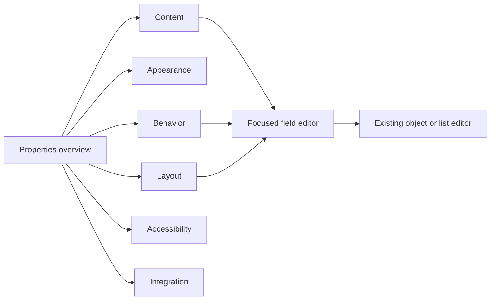

# Inspector organization review — 10 November 2026

KF-PTEZ66: investigate a quieter, more consistently organized selected-node
Inspector. This is a proposed strategy, not an implemented or approved redesign.

## Scope and evidence

The request was to “do a deep visual analysis and come up with a new organizing
strategy that reduces whats on screen simultaneously, that groups consistently
and logically, and that makes better use of whitespace and layout”.

Two independent reviews inspected the rendered **Properties** rail for Button,
TextField and Workbench. An isolated production preview of committed main
`56e4394d992a1ab27d4cfde47676720a7ba3a352` used synthetic documents and intercepted
storage requests. No maintainer documents were changed. Captures cover
1440 → 960 → 390 → 1440 widths at 1000px height, light and dark appearance,
top/middle/bottom scroll positions, no selection and an invalid Ref name.
The Inspector reads synchronous catalog metadata; it has no loading state in
this captured flow. Other tabs and nested editors were read for context, not
independently evaluated as complete flows.

The review uses `ui/CLAUDE.md`, the design philosophy and component-selection
guidance, the shipped editor requirements, and the Inspector model/views.
The second reviewer was a fresh agent given the same verbatim Principal Designer
review lens, intent and captures, without the first review or proposal.

| Selected component | Scroll content | Available content viewport |
| ------------------ | -------------: | -------------------------: |
| Button             |         3150px |                      776px |
| TextField          |         3030px |                      776px |
| Workbench          |         2129px |                      776px |

These are measurements of the three fixtures, not limits or population averages.
Simple field selectors omit complex Configure/content rows. The visible property
counts include more than the simple controls; source already supplies accessible
`props` count labels. Screenshots do not establish contrast ratios, hit areas,
keyboard behavior, screen-reader compatibility or WCAG conformance.

## The Good

- **Hierarchy and layout:** keep the restrained surface, aligned full-width
  controls, pinned selection context, and Properties / Flow / Children split.
  Existing complex values already offer focused drill-in editing.
- **Cognitive load:** reuse the shipped NavStack and dialog model. Object forms
  of at most ten fields push into the rail; larger or multistep forms use a
  dialog. This avoids teaching another editor interaction.
- **Readability:** preserve natural control and text sizes. Dark mode retains
  the same hierarchy; the improvement should come from organizing decisions.
- **Microcopy:** keep the actionable inline Ref name error and the empty state's
  explicit canvas/outline selection routes.

## Critical Issues

1. **High — the initial surface exposes an API rather than an editing task.**
   Button and TextField require roughly four viewport heights before the shared
   integration tools. Unset badge, popup, browser and form details compete with
   ordinary content edits. Ref name and its repeated explanation precede them.
2. **High — “Other” becomes the organizing strategy.** Workbench interleaves
   drawer type, identity, rail type and main header/footer controls. TextField's
   Other mixes typing assistance, identity and sizing. Alphabetical fallback
   scatters related tasks; collapsing that bucket alone would preserve the
   underlying problem.
3. **Medium — integration actions are detached from the field being edited.**
   Promote to a param and Bind a prop repeat property selection below the entire
   form. An unavailable source occupies a persistent form and explanation.
   Advanced currently contains Classes while these technical workflows remain
   separate, always-expanded sections.
4. **Medium — selection identity and vertical rhythm spend space unevenly.**
   Workbench's combined name/type truncates at desktop rail width. A visually
   bare property count and repeated reference help use scarce header/form space.
   Quiet section labels and tightly stacked switches weaken scanning within the
   otherwise spacious form. Some labels expose API vocabulary: Button's
   “Children” also names a different top-level destination.
5. **Medium — the narrow layout amplifies the long-form cost.** At 390px the
   open rail leaves a sliver of preview, below an app toolbar occupying 164px.
   This is an intentional responsive overlay, not evidence of broken layout.
   It nevertheless requires deliberate return context when editing and judging
   a result. At 960px both rails also constrain preview space.

## Actionable Recommendations

### 1. Make Properties a task directory

Start with a concise selection identity and a short public `List` of semantic
destinations. Each row shows a useful summary of authored values, bindings or
errors; opening it pushes one focused group into the existing `NavStack`.
Use `Toolbar` for the page heading and Back. Keep Properties / Flow / Children.
Do not introduce another nested tab strip or an all-expanded accordion.

These are consistent semantic families, not six mandatory rows on every type.
Omit empty families and give complex components meaningful subdivisions. A
focused group must not become a loophole for a twenty-field rail form: preserve
the existing ten-field rule or split the task meaningfully.

### 2. Curate the metadata by task

| Component | Proposed grouping                                                                                                                                                                                                                 |
| --------- | --------------------------------------------------------------------------------------------------------------------------------------------------------------------------------------------------------------------------------- |
| Button    | Content: visible text, icon, badge. Appearance: tone, emphasis, size, shape, fill. Behavior: action, interaction state, link/form and popup subgroups. Accessibility: accessible label and relevant state semantics.              |
| TextField | Content: label, placeholder, hint. Behavior: input/value, validation, typing assistance and state subgroups. Appearance: size and optional controls. Accessibility: accessible label and related semantics.                       |
| Workbench | Layout: Main, Left rail, Right rail and Bottom drawer destinations. A region keeps its content, toolbar, header/footer and placement controls together. Keep component identity/accessibility distinct from region configuration. |

Every property needs exactly one canonical editing location. Resolve exact
`link`, state/accessibility and cross-field semantics from the catalog before
implementation. Contextual links may lead to that location without duplicating
controls. Custom catalogs need a complete fallback and a migration-compatible
metadata contract.

Keep an explicit **All properties** route with search over human labels and API
names. Search should lead to the canonical group and field. Do not hide unset
settings entirely or confuse a default, an unset value and explicit `false`.
Do not infer usage frequency from these three synthetic documents.

### 3. Put binding and promotion at their point of use

Offer clearly named field actions and summarize an existing binding beside its
value. Explain an unavailable source when the action is invoked. Retain a central
bindings overview if established workflows need it; remove duplicated selection
work rather than removing capability. Put Classes and Data attributes in
Integration. Preserve typed sources, scope checks and generated contracts.

### 4. Spend whitespace on relationships

Keep the component type readable separately from a long author name. Make rename
a concise, deliberate edit with help when needed; keep validation visible.
Label the property count visually if it remains useful, otherwise omit it.
Use task-facing labels such as Button text while preserving API-name search.

Use existing component-owned insets, 8px row rhythm and 24px major separation.
Keep natural 44px controls. Prefer a clear task heading and related field groups
over smaller controls, custom wrappers, added cards or decorative borders.
Unused canvas in these fixtures does not prove real documents can surrender
preview space to a wider or multicolumn Inspector.

### 5. Preserve context across navigation and sizes

Treat compact editing as a focused surface with a clearly named return to
preview. Use the same group names/order across sizes. Back restores the invoking
row and focus; returning wide preserves relevant group, draft and scroll state.
A new selection must not inherit an irrelevant nested editor path.

Validation must surface on its owning group and lead to the field, including
inside a closed group. Verify custom catalog fields, bindings, undo/redo, nested
editors, keyboard operation, zoom, screen-reader labels and light/dark modes.
Compare representative editing tasks with the current form before claiming a
usability improvement. No usability study or redesigned prototype was run here.

### Reconciliation and decisions still needed

Both reviewers independently identified long-form exposure, broken Other
taxonomy, detached binding/promotion, and compact context switching. Both favor a
task directory with focused editing and preserving current controls/editors.

They differed in taxonomy granularity. One proposed six stable families; the
other proposed task-specific top-level entries such as Link & form, Typing
assistance, and separate Workbench header/footer destinations. The synthesis uses
stable semantic families with meaningful component-specific subdivisions. The
exact labels, depth and any always-visible quick content editor remain design
judgments for review. Neither reviewer established which fields people use most.

The first review emphasized header management actions; the second gave greater
weight to implementation-facing labels. Both are retained as identity/microcopy
work, without claiming existing icon actions lack accessible names. Neither
review supports widening the Inspector, shrinking fields or certifying
accessibility from the captures.

Follow-up tickets hold implementation decisions and acceptance checks. They need
maintainer review before implementation; completing this investigation does not
approve or ship the proposed interaction.

- KF-QWDPM3: task directory and focused property navigation.
- KF-4BPSTB: consistent component-specific grouping metadata.
- KF-FN28S3: contextual binding and parameter promotion.
- KF-HP1J4Z: selection identity, field labels and spacing rhythm.
- KF-EGNN3J: compact editing and return-to-preview continuity.
